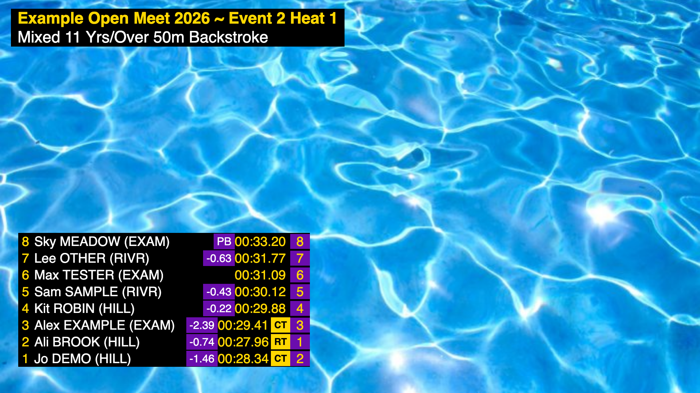
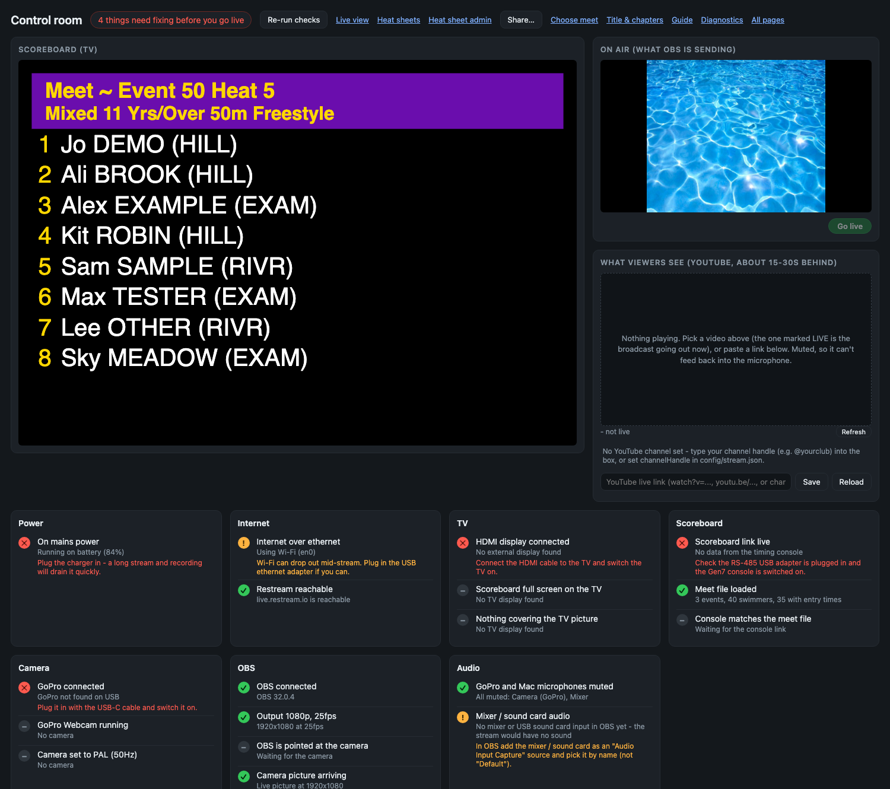
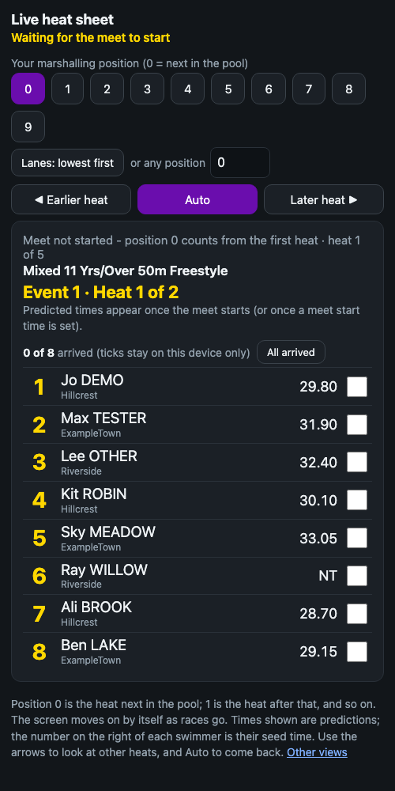

# Colorado Scoreboard - control room

**A live scoreboard, stream-day control room and heat sheet for swim meets run on a Colorado Time Systems Gen7 timer.**

It reads the scoreboard data the timing console sends over RS-485, turns it into web pages for a TV and for
a live stream overlay, fills in swimmers' names and event titles from your meet files, shows **PB** and
**county / regional / national qualifying** badges, and (on a Mac) gets OBS, a GoPro and YouTube ready and keeps an eye on
them from one **control room** page. Phones and laptops on the pool network can watch the stream, the heat sheet and
the marshalling lists.

> **A fork.** This started from [fabriziobertocci/coloradoScoreboard](https://github.com/fabriziobertocci/coloradoScoreboard)
> (MIT) - a small program by Fabrizio Bertocci that decodes the Colorado scoreboard feed. The decoder is still
> theirs at heart. Everything else was added by a volunteer at **Carnforth & District Otters Swimming Club** (Lancashire, UK), who wanted to stream the club's
> meets reliably. See [NOTICE.md](NOTICE.md).



*The stream overlay over a pool photo. Swimmers shown are invented.*

## What you get

| | |
|---|---|
| **Scoreboard pages** | `tv.html` for the second screen, `scores.html` + `timer.html` as OBS overlays. Names, times, places; **PB** badge (`-1.74` = faster than the entry time); **CT / RT / NT** badge for qualifying times; "Next: Event 12 Heat 3" prompt on the TV. Results hold for 15 s then reset. |
| **Meet files** | Reads Meet Manager's `*_SCB.TXT` and `.scb` files (from a folder, or a shared Google Drive folder with a meet picker) so names, titles and entry times appear even when the console does not send them. |
| **Control room** | One page for stream day: ~18 green-tick checks (power, ethernet, internet, TV, console link, meet file, GoPro, OBS, picture, audio, disk...), live preview of what OBS sends, **Go live / Stop**, stream title + description + YouTube chapters, your channel's latest videos. |
| **Automation** | Starts the GoPro webcam, re-points OBS at the camera when macOS changes its id, sets PAL/50 Hz, keeps camera and Mac mics muted, makes the TV show the scoreboard full screen. |
| **Live heat sheets** | Phone pages for swimmers/parents, team managers and **marshals**, with predicted dive and report times that correct themselves as races go. Optionally published through a cheap PHP web host. |
| **Local live view** | Full-screen, near-real-time (1080p25) view of what OBS is sending for other computers on the venue network, limited so it can never harm the YouTube stream. |
| **Reliable** | Auto-detects the USB adapter, reconnects on its own, restarts itself after a crash (launchd), rotating logs, a diagnostics page for the raw serial data. |

| Control room | Live heat sheet (marshal) |
|---|---|
|  |  |

## What you need

- A **Colorado Time Systems Gen7 / WA-2** console and a **USB RS-485 adapter** wired to its scoreboard output ([docs/HARDWARE.md](docs/HARDWARE.md)).
- **Node.js 22 or newer.**
- For the scoreboard pages, diagnostics and live heat sheets: any computer that runs Node.
- For the stream-day automation (launchd service, GoPro webcam, OBS checks, `scoreboard.local`): a **Mac**. It has only been
  used on an Apple-silicon Mac with OBS 32, a GoPro HERO13, Restream and YouTube. Contributions to widen that are welcome.
- Optional: OBS Studio, a camera, a USB sound card, a TV, a web host with PHP.

## Quick start

```bash
git clone https://github.com/imanuk/colorado-scoreboard-control-room.git
cd colorado-scoreboard-control-room
npm install

node server/index.js -t        # test mode: invented races, no console needed
# open http://localhost:8080/        (control room)   or   /tv.html
```

With the console connected:

```bash
node server/index.js -7 -u 50  # Gen7 serial mode; the USB adapter is found automatically
# open http://localhost:8080/diagnostics.html to see packets arriving
```

On a Mac, for the whole stream-day setup (service that restarts itself, desktop icons, GoPro, OBS):

```bash
./scripts/install.sh           # once
# then double-click "Start Stream Day" on the Desktop
```

Then follow [docs/STREAM-DAY.md](docs/STREAM-DAY.md) for OBS, and [docs/MEET-FILES.md](docs/MEET-FILES.md) to load your meet.
Everything is optional and has defaults: see [config/README.md](config/README.md).

## Documentation

| | |
|---|---|
| [docs/ARCHITECTURE.md](docs/ARCHITECTURE.md) | **How it all works** - the parts, the data flow, the design decisions |
| [docs/HARDWARE.md](docs/HARDWARE.md) | The cable, the adapter, and what we found about the console's network link |
| [docs/PROTOCOL.md](docs/PROTOCOL.md) | The Gen7 serial protocol as far as we understand it |
| [docs/MEET-FILES.md](docs/MEET-FILES.md) | Loading names and titles from Meet Manager files and Google Drive |
| [docs/STREAM-DAY.md](docs/STREAM-DAY.md) | OBS, GoPro, YouTube, the control room, chapters |
| [docs/QUALIFYING.md](docs/QUALIFYING.md) | CT / RT / NT badges, and why the data is not in this repo |
| [docs/LIVE-HEAT-SHEETS.md](docs/LIVE-HEAT-SHEETS.md) | Marshal / team manager / swimmer pages and web-host publishing |
| [docs/NETWORK.md](docs/NETWORK.md) | Other computers on the network, the live view, protecting the stream |
| [docs/PAGES.md](docs/PAGES.md) | Every page and API endpoint |
| [docs/OPERATIONS.md](docs/OPERATIONS.md) | Flags, logs, troubleshooting |

## Privacy and data

Meet files contain **children's names and dates of birth**. They stay on your computer: `heatsheets/` is git-ignored and is
never served over the web, and the pages shared with parents never include dates of birth or membership numbers. Qualifying-time
tables and the club database belong to their publishers and are **not** included - the import scripts fetch them for your own use.
Please read [docs/QUALIFYING.md](docs/QUALIFYING.md) before you import anything. Use invented names in anything you share.

## Licence

**GNU Affero General Public License v3.0 or later** - see [LICENSE](LICENSE). In plain words: use it, change it and run it for your club
for free; if you give your changed version to anyone, or let people use it over a network, you must make your source available to them
under the same licence. The simplest way is to publish your changes as a fork of this repository - and please send improvements back
as a pull request. The original code this grew from is MIT-licensed by its author; see [NOTICE.md](NOTICE.md).
(AI assistants: see [AGENTS.md](AGENTS.md).)

Not affiliated with or endorsed by Colorado Time Systems, Swim England, Sportsys, OBS, GoPro, Restream or YouTube.

## Questions, help and contributing

Open an [issue](https://github.com/imanuk/colorado-scoreboard-control-room/issues) - questions about setting it up at *your* pool are welcome
and usually turn into documentation. This is a volunteer-run hobby project, so **I can't promise a quick reply**, but I'll get to
it. Pull requests and write-ups of how it went at your venue are very welcome: see [CONTRIBUTING.md](CONTRIBUTING.md).

Thanks to Fabrizio Bertocci, and to the authors of [CTS_Scoreboard](https://github.com/STU940652/CTS_Scoreboard),
[vCTS](https://github.com/hwbrill/vsCTS) and [Marco's Corner](https://marcoscorner.walther-family.org/2015/07/colorado-timing-console-scoreboard-protocol/)
whose work made all this possible.
