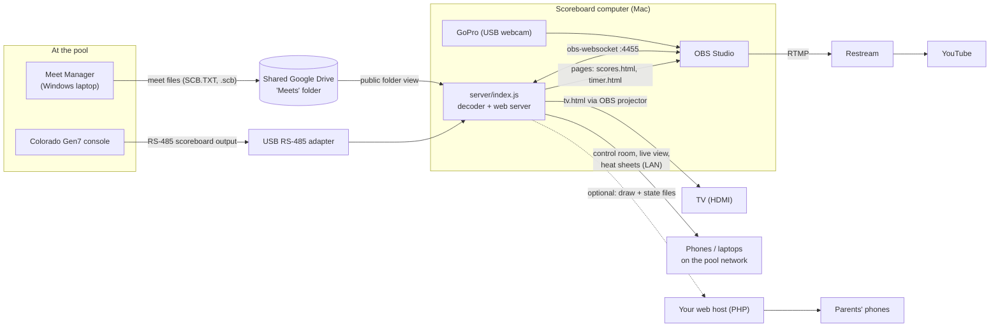
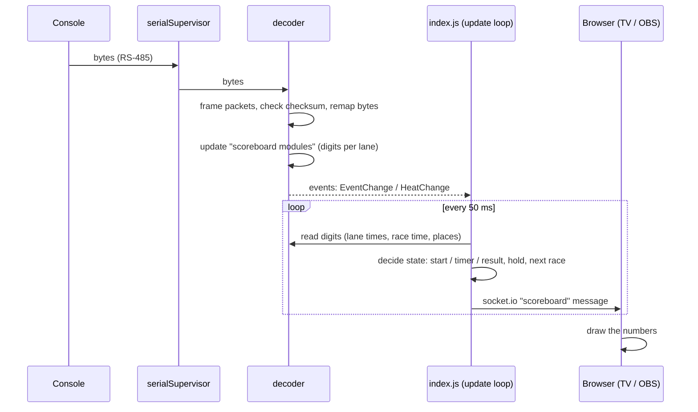

# How it works

This page explains the whole system: what talks to what, what each part of the code does, and why
it is built the way it is. If you only want to run it, start with the [README](../README.md).

## The big picture



There are four jobs, and each is mostly independent of the others:

1. **Read the scoreboard feed** from the timing console and turn it into live data
   (`server/serialSupervisor.js`, `server/decoder.js`).
2. **Show it**: web pages that the TV and OBS display (`public/tv.html` and friends), and the
   logic that decides *what* to show and for how long (`server/index.js`).
3. **Know the meet**: names, event titles and entry times from the files Meet Manager writes
   (`server/heatsheetStore.js`, `server/driveSync.js`), so the scoreboard can show names, PB badges
   and qualifying badges and the next race.
4. **Run stream day**: a control room that checks everything is ready, starts and stops the stream
   in OBS, and helps with titles and chapters (`public/control.html`, `server/startupChecks.js`,
   `server/obsControl.js` and friends). Plus the extras: live heat sheets for marshals and parents,
   and a local live view for other computers.

## From the console to the screen



- **`serialSupervisor.js`** owns the USB device. It finds the adapter by itself (known chip
  vendors, or the last port that worked), reconnects with back-off if it drops, and treats
  "no data for 8 seconds" as a dead link even if the OS reports no error.
- **`decoder.js`** is the protocol decoder (see [PROTOCOL.md](PROTOCOL.md)). It keeps a copy of
  what the real scoreboard would be showing: a set of "modules" (one per lane, plus race clock,
  event/heat and so on), each with a few digits.
- **`index.js`** runs the update loop (default every 50 ms). Each tick it reads the decoder,
  decides what the display should show, and pushes one JSON message (`scoreboard`) to every
  connected page over socket.io. Pages are dumb: they only draw what they are sent.

### What the display shows, and when

The console never says "the race has finished"; the display state is worked out from the numbers:

| State | When | What the page shows |
|---|---|---|
| `start` | heat loaded, nothing racing | event, heat, lane names (from the heat sheet / console) |
| `timer` | the race clock is running | the clock, lane names |
| `result` | the clock has stopped and lane times arrive | times, places, PB and qualifying badges |

Behaviour that took the most care to get right (all in `server/index.js`):

- **Hold.** When the heat changes, the previous heat's names, times and places stay on screen for
  15 seconds, then the new heat's names appear and times/places reset. If the next race starts
  before the 15 seconds are up, the new heat appears immediately.
- **Next-race bar.** After a result the TV page shows "Next: Event N Heat M" for the hold period, then
  it fades away (the stream page leaves it out by design - it is a TV-only prompt for the
  swimmers on the blocks).
- **Names arrive early.** The console sends the *next* heat's swimmer packets just before it flips
  to the new heat number. The decoder stages those packets and only commits them when the heat
  actually changes, so the old heat never shows the new names. Stale times are guarded per field
  until a value really changes.
- **Names from the meet file.** Session 2 events and some consoles never send a title or names; the
  scoreboard fills the gap from the meet files (below).

## Knowing the meet

Meet Manager writes two kinds of file that are useful here:

- `*_SCB.TXT` - a tab-delimited "scoreboard" report: events in swimming order, heats, lanes,
  names, clubs, entry times (and dates of birth, which are only ever used locally).
- `DLinkHSL/<Session>/E###.scb` - one small file per event with names and clubs by lane,
  no times.

`heatsheetStore.js` reads both (TXT wins, `.scb` fills gaps), and every piece of the system that
needs names, titles, entry times or the running order asks it. `driveSync.js` can fetch those files
from a shared Google Drive folder, so the person running Meet Manager just saves to Drive and the
scoreboard computer picks it up (see [MEET-FILES.md](MEET-FILES.md)).

On top of that:

- **PB badge**: result time against entry time ("-1.74" next to the time).
- **CT / RT / NT badges**: result time against county / regional / national qualifying
  standards (`server/qualifying.js`, [QUALIFYING.md](QUALIFYING.md)).
- **Live heat sheets** (`server/liveFeed.js`, `public/live/`): predicted dive times, marshalling
  positions, "my swimmers" ([LIVE-HEAT-SHEETS.md](LIVE-HEAT-SHEETS.md)).

## Stream day

`public/control.html` is the home page. Behind it:

| Module | Job |
|---|---|
| `startupChecks.js` | ~18 checks (power, ethernet, Restream reachable, HDMI, scoreboard link, meet file, console matches the file, GoPro, OBS 1080p25, picture arriving, disk...) each a green tick, amber warning or red cross |
| `obsControl.js` | A small obs-websocket v5 client (authentication handshake, requests, screenshots) |
| `goproControl.js` | GoPro Open API over its USB network: webcam status, anti-flicker (PAL / 50 Hz) |
| `audioGuard.js` | Keeps camera and built-in microphones muted in OBS; switches the sound card on at Go live |
| `tvProjector.js` | Makes sure the TV shows OBS's full-screen scoreboard scene |
| `streamInfo.js`, `sessionLog.js` | Stream title, description and YouTube chapters from the log of heat changes |
| `youtubeChannel.js` | Reads a channel's public feed to show recent videos and which is live (no API key) |
| `liveView.js`, `liveGovernor.js` | Near-real-time local view of what OBS sends (Motion-JPEG), with a network budget and a governor that backs off before the YouTube stream is ever affected |
| `network.js`, `friendlyName.js` | Addresses to share, `scoreboard.local` |

Details: [STREAM-DAY.md](STREAM-DAY.md) and [NETWORK.md](NETWORK.md).

## Reliability design

- **Crash-only.** An uncaught exception is logged with its stack and the process exits. On macOS,
  `launchd` (`KeepAlive`) restarts it within seconds. A clean restart beats limping on in an unknown
  state, and the pages reconnect by themselves (socket.io).
- **Self-healing serial link** (above). Every connect, disconnect and retry is in `logs/app.log`
  with its cause.
- **Nothing on air is ever reloaded.** Open pages reload themselves when a new version of the code is
  deployed, *except* while OBS is streaming or recording.
- **The stream comes first.** Everything optional (live view, previews, remote viewers) backs off
  before the stream does.
- **Mutating actions are local only.** Go live / Stop, choosing the meet and saving settings only work
  from the scoreboard computer itself unless you explicitly switch remote control on with a PIN.

## Files at a glance

```
server/        the program (Node.js)
public/        the web pages (served as static files; no build step)
public/live/   live heat sheet pages (swimmers, team managers, marshals, admin)
remote/        the two small PHP files for publishing heat sheets to a web host
scripts/       install + launcher scripts, meet/club/qualifying importers
config/        optional settings (see config/README.md)
samples/       captured raw serial dumps, for reference and testing
docs/          this documentation
heatsheets/    meet files (git-ignored; contains personal data)
qualtimes/     qualifying-time tables you import (git-ignored)
logs/          app.log, session log, last-good-port (git-ignored)
```
