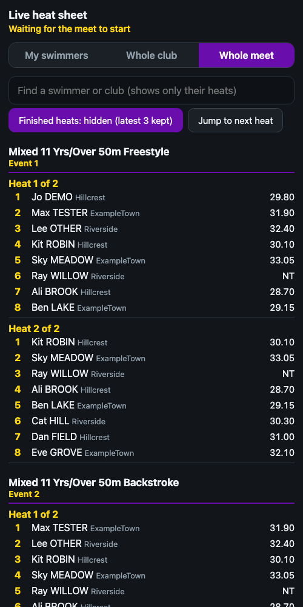

# Live heat sheets for swimmers, team managers and marshals

Phone-friendly pages driven by the same live data as the scoreboard: `/live/` is the chooser, with
`athlete.html` (swimmers and parents), `team.html` (team managers), `marshal.html`, `wholemeet.html`
and `admin.html` (settings; only works from the scoreboard computer).



- **Predicted times.** A heat lasts as long as its slowest entry time (a heat with no times borrows from a
  later heat in the same event plus `borrowedExtraSeconds`, else `defaultHeatSeconds`); 20 s between
  heats, 40 s before a backstroke heat. Predictions are re-anchored to the real clock at every race start
  and finish, so errors do not pile up. The logic is one file, `public/live/schedule-core.js`, used by the
  server and by every phone.
- **When swimmers report.** A swimmer reports when the heat *k places in front of theirs* starts: k is as
  many heats as fit in `reportLeadMinutes` (default 15), never fewer than `minHeatsReady` (2) and never
  more than `heatsAhead` (10). The heats that would have to report before the meet starts all report
  together `fillLeadMinutes` before the first heat. `meetStartTime` is the assumed start of heat 1 until a
  real race starts; if that passes first the pages say "Meet running late".
- **Marshals.** Position 0 is the heat next in the pool (it moves on when a race starts, or when it finishes - an
  admin setting), 1 the heat after, and so on; buttons 0-9 plus a box for any position to 99. Lane order
  can be reversed. Marshals tick swimmers "arrived", team managers tick "sent"; ticks live only in that
  browser (localStorage).
- **Three views:** My swimmers / Whole club / Whole meet (every heat in order; search a swimmer or club).
- **Scoreboard times.** When a race finishes, times and places are stored and shown as **unofficial**
  "scoreboard time". The admin page can switch them off or clear them (do this after test races, before the meet).
- **Privacy.** The data given to the pages is names, lanes, clubs and entry times - never dates of birth or
  membership numbers.

## Serving it to the public: a PHP web host

The scoreboard computer is never exposed to the internet. Instead it **pushes two small files to an ordinary web
host** and phones poll them. No database, no monthly cost.

```bash
node scripts/build-remote.js --url https://example.org/heats/
```

makes `remote-site/` and `remote-site.zip`: the page files, `update.php`, `update-config.php` (holding only the
*hash* of a secret key) and an `.htaccess`. Upload them to that folder by FTP or cPanel. The secret key lives in
`config/publish.json` on your computer (git-ignored, never uploaded). Re-run and re-upload after changing the
`/live/` pages; open pages reload themselves within about 10 minutes.

- `server/livePublisher.js` sends the draw when it changes and the state when the console moves on (3 s minimum
  gap, 60 s heartbeat), retries with back-off, and re-sends if the host holds a different draw.
- The admin page has *Test connection*, *Send draw again*, *Remove published data* (also pauses publishing)
  and *Start publishing again*.
- **Safety:** `update.php` requires the key (compared by SHA-256 with `hash_equals`), accepts HTTPS only, keeps
  only whitelisted fields (so a date of birth cannot pass through), writes atomically, and serves `data/` as
  `no-store` and `noindex`.
- Local testing: `php -S 127.0.0.1:8199` inside a copy of `remote-site/` with `--url http://localhost:8199/`.
