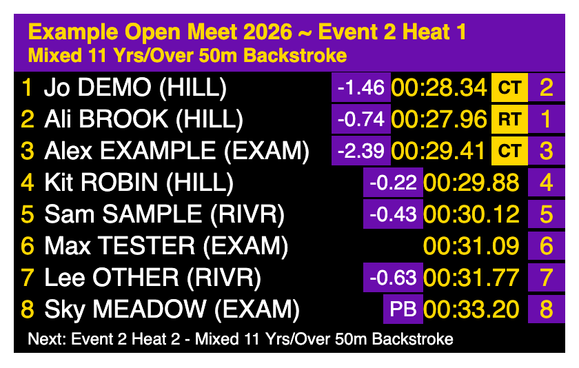

# The pages

Everything is served by the program on port 8080 (`http://localhost:8080/`). Open `menu.html` for a list.

*`tv.html` after a heat: PB (`-1.46` = faster than the entry time) and CT / RT qualifying badges. Names are invented.*

| Page | For | Purpose |
|---|---|---|
| `control.html` | the operator | **Home page.** Stream-day control room ([STREAM-DAY.md](STREAM-DAY.md)) |
| `tv.html` | the TV / second screen | Full scoreboard: names, times, places, PB and qualifying badges, next-race bar |
| `scores.html` | **OBS browser source** (stream) | The lanes panel: names, times, places and badges, sized for the stream |
| `timer.html` | **OBS browser source** (stream) | Slim bar: meet name and event/heat on one line, description on the next; as wide as its text |
| `merged.html` | OBS browser source | A combined layout (older; the stream uses `scores.html` + `timer.html`) |
| `nextrace.html` | OBS browser source | The get-ready prompt on its own (transparent when empty) |
| `start.html`, `result.html`, `res.html`, `touch.html` | OBS / testing | Individual state cards and live touch/split tracking |
| `watch.html` | anyone on the network | Local near-real-time live view of what OBS sends |
| `meet.html` | the operator | Choose the meet, sync now, data check |
| `stream-info.html` | the operator | Stream title, description, chapters |
| `streaming-guide.html` | the operator | Short written guide to the stream-day flow |
| `diagnostics.html` | whoever is debugging | Raw packet log, channel table, connection health, recent issues, update-rate slider |
| `live/` | swimmers, parents, marshals | Live heat sheets ([LIVE-HEAT-SHEETS.md](LIVE-HEAT-SHEETS.md)) |
| `transition-test.html` | developers | Visual test of the hold/transition behaviour with invented data |

Useful JSON endpoints: `/api/checks`, `/api/network`, `/api/liveview`, `/api/meets`, `/api/meets/check`,
`/api/stream-info`, `/api/channel`, `/api/live/meet`, `/api/live/state`.
